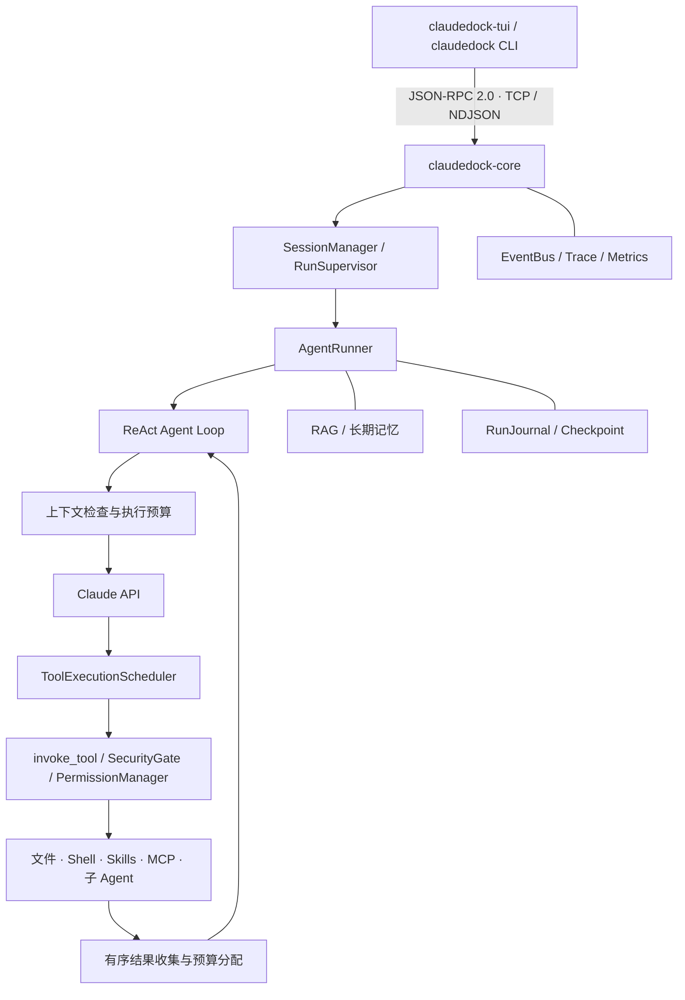

# ClaudeDock

**本地 AI Coding Agent · 可控的工具执行 · 可持续的长任务协作**


ClaudeDock 是参考 Claude Code 架构实现的本地 AI Coding Agent，采用**守护进程 + TUI/CLI 客户端**架构，通过 JSON-RPC 2.0 实现多客户端通信与会话管理。

项目以 ReAct Agent Loop 为核心，支持工具调用、Skills、MCP 和多 Agent 协作，并围绕上下文管理、长期记忆、RAG 检索、权限安全及运行可靠性进行工程化升级。TUI 是主要交互界面，CLI 用于脚本调用和调试。

[快速开始](#快速开始) · [核心功能](#核心功能) · [架构](#架构) · [配置](#配置) · [开发与测试](#开发与测试) · [文档导航](#文档导航)

## 核心功能

| 能力 | 实现方式 |
| --- | --- |
| 上下文工程 | Token Budget、Microcompact、滚动摘要、高低水位、压缩间隔与增长阈值；大工具结果外置保存和有界预览 |
| 长期记忆 | SQLite 权威存储与检索索引分层；支持跨会话召回、项目隔离、去重、冲突消解和后台整合 |
| RAG 混合检索 | BM25 + Embedding 双路召回与 RRF 排序；支持查询改写、查询拓展、元数据过滤、增量索引及可选精排 |
| 工具与权限 | ToolRegistry 统一注册与参数验证；静态规则、权限模式、人工审批和执行前复核共同约束工具调用 |
| MCP 接入 | 工具发现和异步调用；Schema 校验、宿主能力授权、工具身份和参数作用域绑定 |
| 多 Agent 协作 | planner / executor / reviewer 角色、前台或后台子任务、结构化交接，以及父子任务共享预算与执行槽 |
| 冲突感知调度 | 根据可信工具元数据和资源读写关系构建依赖；双层限流、结构化并发、串行屏障和有序结果提交 |
| 运行可靠性 | 时间、Token 和调用次数预算；按安全声明重试；操作日志、Checkpoint、取消传播及保守中断恢复 |
| 可观测性 | 事件推送、Trace、上下文和工具执行指标；可选 OpenTelemetry 导出 |

部分功能需要显式配置。RAG、长期记忆、工具并行及增强上下文开关的默认值与启用方式见下文，不能把功能支持等同于默认启用。

## 架构



模型提出工具调用，宿主根据工具身份、权限和资源访问关系决定是否执行、是否可以并发。每轮工具结果收齐后，Loop 才发起下一次模型请求。

会话、单次运行和后台子 Agent 分别管理：会话保存交互历史，运行持有执行状态与预算，后台子 Agent 由 Supervisor 托管。客户端重连与任务状态查询通过守护进程完成；待审批请求仍受连接归属及超时约束。

## 快速开始

### 环境要求

- Linux 或 Windows WSL2；Shell 沙箱及部分文件工具依赖 Linux 系统接口。
- Python **3.12.x**，项目限定为 `>=3.12,<3.13`。
- 已安装 `uv`。
- 可用的 Anthropic API 凭证。

### 安装与配置

克隆或下载仓库后，在项目根目录执行：

```bash
uv sync --frozen
cp .env.example .env
```

编辑 `.env`，填写自己的凭证：

```dotenv
ANTHROPIC_API_KEY=your-anthropic-api-key
CLAUDEDOCK_LLM_DEFAULT_MODEL=claude-sonnet-4-6
```

`.env` 仅用于本地配置，不应提交到 Git。仓库示例文件不包含真实 API 密钥。

### 启动守护进程

```bash
uv run claudedock-core
```

默认监听 `127.0.0.1:7437`。保持此终端运行，在另一个终端启动主界面：

```bash
uv run claudedock-tui
```

TUI 支持流式回答、工具调用展开、权限审批和运行中断。内置 Skills 包括 `/init`、`/review`、`/summarize` 和 `/orchestrate`。

### CLI 调试

```bash
uv run claudedock --version
uv run claudedock ping
uv run claudedock run --goal "读取项目结构，介绍主要模块"
uv run claudedock chat
uv run claudedock trace --follow
```

需要 Shell 执行时，宿主会检查沙箱后端；首次配置请参考[安全实施说明](docs/production/security-implementation-2026-10-15.md)与[运维手册](RUNBOOK.md)。

## 配置

常规配置优先级由低到高：

```text
内置默认值 → ~/.claudedock/config.toml → .claudedock/config.toml → .env → 环境变量
```

未知配置键会直接报错。权限与 MCP 授权必须来自受信的私有全局配置，项目配置和 `.env` 不能授予这些安全权限；安全相关启动变量也有独立的来源约束。

| 配置项 | 用途 |
| --- | --- |
| `CLAUDEDOCK_HOST` / `CLAUDEDOCK_PORT` | 守护进程监听地址和端口 |
| `CLAUDEDOCK_CONFIG` | 显式指定配置文件路径 |
| `CLAUDEDOCK_LLM_DEFAULT_MODEL` | 默认模型 |
| `CLAUDEDOCK_LOG_LEVEL` / `CLAUDEDOCK_LOG_FORMAT` | 日志级别与格式 |
| `CLAUDEDOCK_RAG_ENABLED` / `CLAUDEDOCK_RAG_API_KEY` | 启用 RAG 与配置 Embedding 凭证 |
| `CLAUDEDOCK_MEMORY_ENABLED` | 启用长期记忆 |
| `CLAUDEDOCK_RUNTIME_*` | 并发、运行时长、Token 和调用次数等资源上限 |

全局配置目录默认为 `~/.claudedock/`；项目扩展位于 `.claudedock/`。只提交经过审核的项目上下文，不提交私有配置、Token、运行日志或本地快照。

### RAG 与长期记忆

```dotenv
CLAUDEDOCK_RAG_ENABLED=true
CLAUDEDOCK_RAG_API_KEY=your-embedding-api-key
CLAUDEDOCK_RAG_EMBEDDING_MODEL=embedding-3
CLAUDEDOCK_RAG_EMBEDDING_DIMENSIONS=2048
CLAUDEDOCK_RAG_RETRIEVER=auto
CLAUDEDOCK_MEMORY_ENABLED=true
```

`auto` 模式在配置 Embedding 密钥时使用混合检索，没有密钥时使用本地 BM25。默认 Embedding 接口是智谱兼容接口；Qdrant 为可选存储后端，启用 RAG 并不要求部署 Qdrant。长期记忆使用独立的数据库、缓存和集合。

### 上下文与并行调度

上下文功能通过 `[compaction]` 配置，完整示例见[上下文配置模板](docs/production/context-compaction.example.toml)。自动压缩、Microcompact、Prompt Cache、结构化交接和工具结果预算分别控制。

并行工具执行默认关闭，可在 TOML 中配置：

```toml
[tool_execution]
parallel_enabled = false
shadow_enabled = false
policy = "safe_only"
max_concurrency_per_run = 4
max_calls_per_batch = 8
max_pending_approvals = 8
```

Shadow 模式保留串行执行，只记录调度规划。启用并行后，默认白名单仅开放经审核的 `read_file` 和 `list_dir`；写入、Shell、MCP、工具发现和子 Agent 启动继续形成串行屏障。宿主资源工具可以在明确审核后扩展资源声明与调度策略。

本地基准没有显示小文件读取的并行收益，是否启用应以实际负载为准，详见[并行工具实施记录](docs/production/parallel-tool-execution-implementation.md)。

## 安全与恢复边界

- **统一执行网关**：生产工具调用经过 `invoke_tool`，执行参数校验、权限评估、审批、限时调用及审计。
- **授权不可由模型授予**：工具结果、仓库说明、Skills、检索结果、记忆和压缩摘要都是外部数据，不能覆盖宿主策略或表示用户已经批准。
- **审批绑定调用**：权限与工具身份、参数摘要、策略版本和期限关联；等待审批不占用实际工具执行槽。
- **重试遵循工具声明**：不会因为批次失败而整体重放有副作用的操作。
- **恢复保守处理未决状态**：超时或取消不代表副作用没有发生；结果未知的操作需要核查，不能依靠重试推断状态。
- **本地日志有能力边界**：Checkpoint 和操作日志不能替代外部服务的事务或业务幂等账本。运行完成状态也不替代对代码和任务结果的验收。

## 项目结构

```text
src/claudedock/
├── core/
│   ├── app.py, runner.py, loop.py  # 守护进程、运行装配、Agent Loop
│   ├── context.py, compact/       # 上下文、压缩、工具结果存储
│   ├── tools/                    # 工具注册、执行网关与调度
│   ├── security/, permissions/   # 安全策略与审批
│   ├── session/, subagent/       # 会话与子 Agent
│   ├── rag/, memory/             # 检索与长期记忆
│   ├── skills/, agents/, mcp/    # 技能、角色与 MCP
│   └── bus/, transport/, trace/  # IPC、事件与追踪
├── tui/                          # Textual 主界面
├── cli/                          # 命令行入口
└── eval/                         # 检索与生成评估
tests/                            # 单元、集成与基准测试
scripts/                          # 检查、评估与运维脚本
docs/                             # 架构、使用、评测与生产说明
```

## 开发与测试

```bash
uv sync --frozen
uv run ruff check src tests scripts
uv run mypy src
uv run pytest tests/ -q
uv run python scripts/gen_protocol_doc.py --check
```

开发时还可以使用：

```bash
make dev                  # 启动守护进程
make test-unit            # 单元测试
make test-integration     # 集成测试
make benchmark            # 工具执行基准
make docs                 # 重新生成协议文档
```

常规自动化测试主要使用模拟模型和本地测试服务；真实 RAG/生成评估需要单独配置对应服务凭证。测试与基准结论仅适用于各自记录的环境和数据集。

`WIRE_PROTOCOL.md` 由 Pydantic 协议模型自动生成，修改命令或事件模型后请同步生成。

## 容器运行

```bash
docker build -t claudedock:latest .
```

Compose 提供守护进程和 Qdrant 服务。启动前，在本地环境配置独立的 `CLAUDEDOCK_IPC_TOKEN`、`QDRANT_API_KEY` 和模型凭证：

```bash
docker compose up -d
docker compose logs -f claudedock-core
```

容器对外端口默认仅绑定宿主机 loopback。IPC 的网络暴露、TLS、沙箱和离线构建说明见[运维手册](RUNBOOK.md)、[生产运维说明](docs/production/operations.md)和[离线依赖缓存说明](build-assets/README.md)。

## 文档导航

| 文档 | 内容 |
| --- | --- |
| [快速开始](docs/getting-started/quickstart.md) | 安装与基本使用 |
| [架构概览](docs/architecture/overview.md) | 模块职责与数据流 |
| [上下文工程](docs/architecture/context-engineering.md) | 预算、压缩和历史管理 |
| [RAG 设计](docs/rag.md) | 检索、索引与配置 |
| [安全实施记录](docs/production/security-implementation-2026-10-15.md) | 权限、安全边界与部署限制 |
| [并行工具执行](docs/production/parallel-tool-execution-implementation.md) | 调度策略、取消与基准 |
| [名称迁移说明](docs/getting-started/migration.md) | 命令、配置和本地数据迁移 |
| [IPC 协议](WIRE_PROTOCOL.md) | 生成的命令与事件定义 |
| [运维手册](RUNBOOK.md) | 配置、启动和故障排查 |
| [贡献指南](CONTRIBUTING.md) | 开发与提交约定 |

## License

采用 [MIT License](LICENSE)，保留原始版权声明。

ClaudeDock 是独立项目，架构参考 Claude Code，与 Anthropic 官方产品没有隶属关系。
